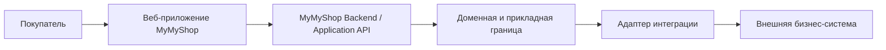

# Архитектура MyMyShop — SHOP-ARCH-01

Исходная архитектурная фиксация сделана на коммите `8232dd5558aad6e6932960926e682bc1a2839903` (2026-10-08); разделы CURRENT обновлены для SHOP-UX-COMMERCE-01. **CURRENT** — подтверждено кодом; **PLANNED** — запланировано, но не реализовано; **PROPOSED** — архитектурное предложение, требующее отдельного решения; **OPTIONAL** — необязательная возможность без утверждённого решения. Упоминание домена или внешней системы не означает наличие развёрнутого backend, поставщика или интеграции.

Сейчас MyMyShop — демонстрационный магазин на React и Fastify backend с app-owned session. Публичные страницы каталога и корзины работают без API, вход в демо-аккаунт требует backend. Сервер не обслуживает commerce. Публичный demo должен честно показывать ограничения локальных данных, заказов и оформления.

**SHOP-BACKEND-FOUNDATION-01 — CURRENT:** [стратегия интеграций](INTEGRATION_STRATEGY.md) закрепляет самостоятельный каталог без credentials; вход в демо-аккаунт использует данные, показанные в UI. Backend отделён от frontend: `server/` содержит Fastify, config, SQLite, миграции, identity verifier, session и profile services. `Order` принадлежит MyMyShop, а не поставщику, но Order и test integrations ещё отсутствуют.

## Возможности: сейчас и в целевой системе

| Возможность | Текущая реализация | Целевая реализация | Влияние на frontend | Влияние на backend и интеграции | Статус |
| --- | --- | --- | --- | --- | --- |
| Каталог | Локальный снимок DummyJSON; дополнительный прямой режим API | API каталога и преобразование моделей | Убрать выбор источника из страниц за контракт | Владелец каталога; PIM необязателен | CURRENT / PLANNED |
| Сессия | Backend проверяет публичные демо-данные, затем выдаёт app-owned cookie и SQLite session одному постоянному demo actor; восстановление и выход работают через API | Внешняя identity integration для production | UI использует session service и четыре состояния | Сервер проверяет credentials, токен и actor | CURRENT demo / PLANNED production identity |
| Аккаунт | Защищённый Account shell: `/account`, `/account/profile` с серверным сохранением имени и локальным фото; `/account/orders` и детали с фиксированной историей; `/account/addresses`, `/account/reviews`, `/account/settings` — placeholder; `/profile` перенаправляет | Серверное фото, заказы, адреса, отзывы, настройки | Отдельные экраны и контракты | Владение данными покупателя | CURRENT shell/profile/demo orders / PLANNED business domains |
| Корзина | Redux и версионированный `localStorage` | Серверная корзина и правила согласования | Сохранить действия, добавить сервисную границу | Домен корзины; внешняя система не обязательна | CURRENT / PLANNED |
| Оформление | `/checkout` показывает preview и честно сообщает о недоступности отправки; корзина сохраняется, Order и Payment не создаются | Проверка доставки/самовывоза и создание заказа | Пошаговый сценарий | Сервер проверяет цену, наличие и заказ | CURRENT preview / PLANNED |
| Заказы | Три фиксированные демонстрационные записи и детали; создание заказа отсутствует | Реальная история, детали и действия после покупки | Экраны Account/Orders | Домен заказов; OMS необязателен | CURRENT demo history / PLANNED backend capability |
| Платежи | Нет | Инициация, статусы, возвраты | Статусы и при необходимости защищённый интерфейс поставщика | Серверный адаптер и PSP | PLANNED |
| Отгрузки | Только статическая страница о доставке | Статус и отслеживание | Отслеживание в деталях заказа | Домен исполнения; WMS/перевозчик необязательны | PLANNED |
| Отзывы | API-источник запрашивает `reviews`; в текущем локальном снимке данных отзывов нет. Полноценный пользовательский UI и отправка не реализованы | Отображение, отправка и жизненный цикл отзывов и оценок | PDP и отзывы/оценки в аккаунте | Домен отзывов; модерация необязательна | SOURCE DATA CURRENT / FEATURE PLANNED |
| Поддержка | Локальный ChatBot; форма контакта пишет в console | Обращения и переписка | Интерфейс поддержки | Домен поддержки; CRM/helpdesk необязателен | CURRENT demo / PLANNED |
| Уведомления | Отдельного сервиса нет | Уведомления о статусах | Настройки и сообщения | Домен уведомлений; поставщик необязателен | PLANNED |
| Аналитика | Отдельной интеграции нет | Согласованные события и наблюдаемость | Безопасная граница событий | Инструмент не выбран | OPTIONAL |

## Слои и границы

**CURRENT:** представление находится в `src/pages` и `src/shared`; состояние пользовательских функций и прикладная логика сосредоточены преимущественно в Redux и `src/features`. `sessionService → httpSessionAdapter` и `accountService → httpAccountAdapter` подключены к app-owned session и профилю; корзина хранится в `localStorage`, каталог дополнительно использует RTK Query для DummyJSON. Разделение каталога неполное: `ProductsPage` и `ProductDetailsPage` выбирают `?source=api` и непосредственно используют данные источника. Бизнес-системы не подключены.

**PLANNED — целевая граница:**

Интерфейс должен зависеть от контрактов функций и доменов, а не от конкретного источника данных, SDK поставщика, DTO внешней системы или demo-реализации адаптера. **PLANNED:** MyMyShop Backend / Application API отвечает за учётные данные, достоверные цены, заказы, платёжные статусы, права доступа и внешние интеграции. **PROPOSED:** явные сервисные и доменные границы не требуют отдельных процессов: первоначальный backend **может** быть модульным монолитом. Для микросервисов нет принятого решения или текущей потребности. Исключение для браузера возможно в виде защищённого платёжного интерфейса или перенаправления поставщика; намерением платежа, связью с заказом и проверкой статуса всё равно управляет backend.

## Статический demo и приложение с backend

**CURRENT:** локальный снимок каталога, дополнительный публичный режим DummyJSON и Redux-корзина работают без backend. Демо-вход проверяет email и пароль на сервере и использует server-side cookie session с постоянным demo actor, поэтому функциональному публичному demo нужны HTTPS, API, постоянная SQLite, SPA fallback и abuse protection. Публикация не подтверждена. Внешней identity integration, оформления заказа, Order, Payment и исполнения заказа нет. `/checkout` — предварительный просмотр; корзина сохраняется.

**PLANNED:** production identity provider вместо проверки demo credentials, расширение серверного профиля/аватара, бизнес-функции адресов, реальные Orders и Order Details, Shipment Tracking, Checkout, Payments, Refunds и Support через MyMyShop Backend / Application API и серверные адаптеры интеграций. Демонстрационные Order History и Order Details уже работают на фиксированных снимках. **PROPOSED:** явные сервисные/доменные контракты и преобразование DTO в модели интерфейса; будущий provider заменяет слой проверки личности, сохраняя UI и app-owned session architecture. Будущий ticket отзывов должен проследить путь `данные источника → преобразование/нормализация → модель frontend/домена → представление на PDP`. Контракты, маршруты и схемы утверждаются в следующих tickets.

## Принципы и открытые решения

**Product IA / domain consistency:** до major user-facing реализации фиксируется UX decision summary по [workflow](../CODEX_WORKFLOW.md); бизнес-возможность согласуется во всех затронутых поверхностях, а не только в одном компоненте. Полная структура кабинета может существовать раньше бизнес-возможностей: Orders теперь показывает фиксированные demo данные, Addresses/Reviews/Settings — честные placeholder-состояния. Findings по другим экранам и их отдельные зависимости описаны в [UX/Product audit](UX_PRODUCT_AUDIT.md) и ROADMAP; аудит не добавляет runtime-функции.

- **CURRENT — подтверждённые факты:** [архитектура frontend](FRONTEND_ARCHITECTURE.md) и [среды поставки](DELIVERY_AND_ENVIRONMENTS.md).
- **PLANNED — правило:** UI не интегрируется напрямую с CRM, ERP, WMS, backend API PSP и перевозчика. Изменяемое состояние браузера не является источником истины для чувствительных операций.
- **PROPOSED — правило:** при подключении backend использовать явные контракты функций и преобразование DTO; сохранять границы ответственности и в одном развёрнутом backend.
- **Открыто:** размещение backend, поставщики, commerce API, транспорт настоящей сессии, согласование корзины, способ оплаты, статусы заказа, сроки хранения данных и операционные цели. Stack foundation — Fastify/JavaScript/SQLite; дальнейшие решения принимаются в отдельных tickets. Граница backend и владение `Order` определены в [стратегии](INTEGRATION_STRATEGY.md).

Далее: [контекст системы](SYSTEM_CONTEXT.md), [домены](DOMAIN_MODEL.md), [бизнес-процессы](BUSINESS_FLOWS.md), [интеграции](INTEGRATIONS.md), [границы доверия](SECURITY_BOUNDARIES.md), [среды](DELIVERY_AND_ENVIRONMENTS.md) и [ADR](adr/README.md). [ROADMAP](../ROADMAP.md) определяет порядок реализации. Этот blueprint не закрывает implementation tickets.
