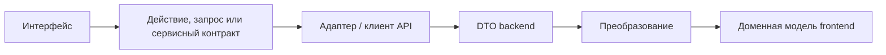

# Архитектура frontend

**SHOP-AUTH-SESSION-02 — CURRENT:** `sessionService → httpSessionAdapter` восстанавливает серверную сессию через `/api/v1/session`. UI различает loading, authenticated, anonymous и unavailable; защищённые `/account/*` открываются только после успешного restore. Login показывает публичные демо-данные и отправляет email/password на backend для проверки, сохраняет локальный `next` и возвращает на защищённый URL. Profile name загружается и меняется через `/me`; фото остаётся локальным до refresh. Demo orders по-прежнему fixture и не принадлежат actor. Ошибка backend не запускает старый in-memory demo adapter.

## CURRENT — устройство репозитория

- `src/main.jsx` подключает React, Redux Provider, BrowserRouter, глобальные стили и i18n. `src/app/App.jsx` задаёт маршруты; `MainLayout` окружает страницы магазина Header, Footer, локальным ChatBot и MobileNavigation. Login расположен вне этого layout. `/checkout` показывает preview без создания заказа, `/register` перенаправляет на login, `/admin` — на главную. Неизвестные маршруты показывают NotFound. Для ленивых страниц есть индикатор загрузки и граница ошибок отображения.
- `src/features` содержит account, auth, cart, orders, products, sale, theme и language; `src/pages` собирает экраны; `src/shared` содержит общие компоненты. Это организация кода, а не полностью выделенный доменный слой.
- `src/app/store.js` настраивает Redux Toolkit и RTK Query `productsApi`. Redux хранит только состояние интерфейса; серверная сессия восстанавливается по HttpOnly cookie. Корзина загружается через `cartPersistence`, а изменения сохраняются подпиской на store. Тема и язык используют настройки браузера.
- `sessionService → httpSessionAdapter` получает состояние серверной сессии без доступа к cookie. Единый Account shell защищает `/account`, `/account/profile`, `/account/orders`, `/account/orders/:orderId`, `/account/addresses`, `/account/reviews`, `/account/settings`; последние три маршрута показывают placeholder. `/account/orders` и детали показывают фиксированную историю примеров. `/account` — главная кабинета, `/account/profile` сохраняет имя через `/me`; фото остаётся в памяти вкладки. `/profile` перенаправляет на `/account`. Backend проверяет cookie независимо от frontend guard.
- Основной каталог использует датированный локальный снимок. `?source=api` обращается непосредственно к DummyJSON через RTK Query для поиска, категорий и PDP. Локальный `catalogPipeline` выполняет поиск, фильтрацию и сортировку. В API-режиме доступны лишь загруженные страницы. `ProductImage` задаёт размер слота, загрузку и заглушку при ошибке. В текущем снимке 194 товаров нет поля `reviews`; API-запрос PDP запрашивает его, а в коде PDP есть базовый компонент `Reviews`. Полноценный пользовательский интерфейс отзывов и их отправка не реализованы.
- Строки корзины — снимки товара и цены в Redux, ссылки учитывают источник. `cartPersistence` проверяет и версионирует данные `localStorage`. CartPage и CartDrawer отображают корзину. CartPage ведёт к `/checkout`, где `checkoutService → demoCheckoutAdapter` сообщает о недоступности оформления и показывает только снимок позиций и их сумму. Корзина не очищается; Order и Payment не создаются. Доставка, наличие, серверная синхронизация и достоверный расчёт окончательной суммы отсутствуют.
- Есть RU/EN i18n и переключение темы. Адаптивный интерфейс включает нижнюю мобильную навигацию. У каталога и ленивых страниц есть отдельные состояния загрузки/ошибки/пустой выдачи, но единой модели для всего приложения пока нет. Playwright проверяет каталог, корзину, сессию, изображения и навигацию; CI запускает проверки на Linux.

## PLANNED — поток данных frontend

Это направление для функций с backend, **не** утверждение о наличии преобразователей во всех текущих функциях. UI и доменный слой должны позволять заменить demo/test adapter на MyMyShop API adapter без переписывания страниц, форм и бизнес-потоков. Demo/test/sandbox adapter должен выполнять реальные операции и запросы к соответствующей системе и честно возвращать ошибки, а не создавать ложный успех. Текущий каталог использует снимок товаров или внешний DummyJSON API и не требует MyMyShop backend API; auth/account уже обращается к нему и использует реальную серверную сессию. RTK Query может остаться механизмом запросов и кеша. В браузере не должны находиться credentials внутренних бизнес-API. Правила загрузки и ошибок будущих серверных операций определяются в следующих tickets.

**PLANNED — крупные продуктовые блоки, здесь не реализуются:** production identity integration и серверное сохранение Customer Profile/аватара; реальные Orders и Order Details; отслеживание отгрузки; управление адресами; полноценное отображение и отправка отзывов и оценок; недавно просмотренные товары; управление настройками; оформление; платежи; доставка/самовывоз; возвраты; поддержка. См. [домены](DOMAIN_MODEL.md) и [процессы](BUSINESS_FLOWS.md). Текущие demo Account и Orders, остальные маршруты с placeholder, Delivery, базовый компонент `Reviews` и ChatBot не равнозначны этим возможностям.

**CURRENT — Account/Orders:** `/account/orders` и `/account/orders/:orderId` показывают фиксированную демонстрационную историю и детали через `orderService → demoOrderAdapter`. Позиции содержат снимки названия, изображения и цены; суммы рассчитаны в центах. Есть защищённый маршрут, состояния списка, ошибки и отсутствующего ID. Демо-вход уже проверяет email/password на MyMyShop backend, а серверная сессия защищает `/me`; регистрация, восстановление доступа и production identity integration ещё не реализованы. Checkout Preview не создаёт заказ. Реальные статусы платежа, отгрузка, отслеживание, возвраты и поддержка остаются следующими tickets.
